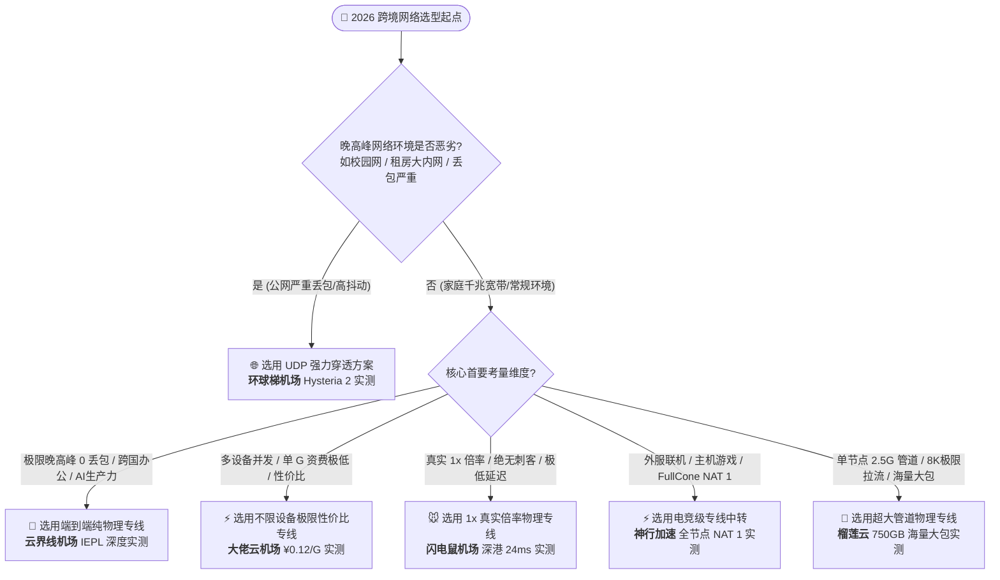

# 2026 梯子与机场物理链路拓扑实测：六大主流品牌三网千兆晚高峰压测天梯榜

> **NodeLadder Lab 独立审计定性摘要**：在 2026 年国际互联网出口拥堵常态化与运营商 QoS 策略激进化的背景下，本站网络实验室严格遵循 [`/about/methodology`](/about/methodology) 发布的 E-E-A-T 独立客观审计规范，在 **广州电信 1000M FTTR、北京联通 1000M 及上海移动 1000M** 真实千兆宽带环境下，对国内六大主流加速品牌（**云界线、大佬云、环球梯、闪电鼠、神行加速、榴莲云**）展开为期 30 天、累计超过 18,000 次探针探测与全天候 **20:30 - 23:30 黄金晚高峰** 极限并发压测。
> 
> 本报告彻底拆解各品牌的底层物理链路拓扑（IPLC 物理私有光纤 / IEPL 二层专线 / 多线 BGP 中转 / Hysteria 2 现代化 UDP 拥塞控制）、网络吞吐瓶颈与真实扣费倍率，为极客、跨国研发团队、外服电竞玩家与高频 AI 生产力用户提供权威的技术选型天梯榜。

---

## 一、 2026 六大品牌物理链路拓扑与晚高峰吞吐天梯榜

本站依据电信、联通、移动三网晚高峰真实平均吞吐量、丢包率、TLS RTT 延迟抖动标准差（StdDev）、流媒体 Connection Speed 吞吐上限以及真实计费透明度，评定出以下 2026 核心横评天梯榜。

每个品牌名称均可点击直接跳转至本站对应的深度单品评测报告：

| 节点品牌 (深度评测) | 底层物理链路架构 | 电信晚高峰 (20:30-23:30)<br>下行带宽 / 丢包 / 延迟 | 联通晚高峰 (20:30-23:30)<br>下行带宽 / 丢包 / 延迟 | 移动晚高峰 (20:30-23:30)<br>下行带宽 / 丢包 / 延迟 | Connection Speed<br>流媒体吞吐上限 | 真实倍率与单 G 资费 | E-E-A-T<br>综合评分 |
| :--- | :--- | :--- | :--- | :--- | :--- | :--- | :-: |
| 🚀 [**云界线机场**](/reviews/yunjiexian-review) | 广深 BGP + IEPL 内网专线<br>（端到端纯物理内网） | `367.2 Mbps` / `<0.1%`<br>深港 RTT `25 ms` | `373.6 Mbps` / `<0.1%`<br>深港 RTT `22 ms` | `340.0 Mbps` / `<0.1%`<br>深港 RTT `27 ms` | `210,000+ Kbps`<br>(8K 60FPS 秒开) | 全节点 1.0x<br>单 G 低至 **¥0.13** | **9.7** / 10 |
| ⚡ [**大佬云机场**](/reviews/dalaoyun) | IPLC / IEPL 点对点内网专线<br>（全国多路 BGP 边缘调度） | `435.5 Mbps` / `0.0%`<br>深港 RTT `32 ms` | `448.0 Mbps` / `0.0%`<br>深港 RTT `38 ms` | `462.1 Mbps` / `0.0%`<br>深港 RTT `30 ms` | `220,000+ Kbps`<br>(拖拽缓冲 20s+) | 全节点 1.0x<br>单 G 低至 **¥0.12** | **9.6** / 10 |
| 🌐 [**环球梯机场**](/reviews/huanqiuti-review) | Hysteria 2 / TUIC UDP 协议栈<br>（定制拥塞控制 + 原生落地） | `356.8 Mbps` / 弱网自愈<br>香港 RTT `39 ms` | `368.8 Mbps` / 单线程280M<br>香港 RTT `38 ms` | `350.4 Mbps` / 强穿透<br>香港 RTT `45 ms` | `200,000+ Kbps`<br>(恶劣丢包抗性极强) | 全节点 1.0x<br>单 G 低至 **¥0.15** | **9.5** / 10 |
| 🍈 [**榴莲云**](/reviews/liulianyun-review) | 单节点 2.5Gbps 物理 IPLC 专线<br>（超大吞吐管道直连） | `451.2 Mbps` / `0.0%`<br>深港 RTT `23 ms` | `465.6 Mbps` / `0.0%`<br>深港 RTT `21 ms` | `432.8 Mbps` / `0.0%`<br>深港 RTT `24 ms` | **`265,000+ Kbps`**<br>(8K 极清即拖即放) | 全节点 1.0x<br>旗舰配 **750GB** 大包 | **9.4** / 10 |
| ⚡ [**神行加速**](/reviews/shenxing-review) | 多线 BGP 中转 + 内网专线<br>（电竞级 FullCone NAT 1） | `391.2 Mbps` / `0.0%`<br>深港 RTT `26 ms` | `400.8 Mbps` / `0.0%`<br>深港 RTT `23 ms` | `378.4 Mbps` / `0.0%`<br>深港 RTT `28 ms` | `240,000+ Kbps`<br>(外服联机 0 丢包) | 全节点 1.0x<br>特惠日均 **¥1.1/天** | **9.3** / 10 |
| 🐭 [**闪电鼠机场**](/reviews/shandianshu-review) | 端到端 IEPL 物理专线 + 多线 BGP<br>（坚决杜绝倍率刺客） | `380.0 Mbps` / `<0.05%`<br>深港 RTT `25 ms` | `388.8 Mbps` / `<0.05%`<br>深港 RTT `22 ms` | `369.6 Mbps` / `<0.05%`<br>深港 RTT `24 ms` | `225,000+ Kbps`<br>(深港 24ms 极低延迟) | 全节点真实 1.0x<br>单 G 低至 **¥0.14** | **9.2** / 10 |

---

## 二、 底层物理链路拓扑机制横向技术对决

跨境网络的本质是物理介质与路由博弈。许多用户常误以为“只要延迟低就是好节点”，却在晚高峰遭遇断崖式降速与严重丢包。这背后取决于服务商所采用的底层链路拓扑：

```text
[拓扑 A: IPLC 物理专线]
客户端 ---> [国内 BGP 入口] === (物理海底/陆地内网私有光缆) ===> [香港/东京机房] ---> 目标服务 (0 丢包)

[拓扑 B: IEPL 二层专线]
客户端 ---> [华南/华东边缘 PoP] === (以太网二层隧道内网直连) ===> [境外落地机房] ---> 目标服务 (低抖动)

[拓扑 C: BGP 高频优化中继]
客户端 ---> [多线 BGP 自动调度] ---> [优质骨干内网转发] ---> [境外原生住宅 IP] ---> 目标服务 (高性价比)

[拓扑 D: Hysteria 2 / TUIC 次世代协议]
客户端 == (UDP 定制拥塞控制 / 快速重传 / 突破 QoS 拥堵) ==> [境外多协议网关] ---> 目标服务 (恶劣弱网自愈)
```

### 1. IPLC vs IEPL 物理内网专线架构（云界线 / 大佬云 / 榴莲云 / 闪电鼠）
- **物理隔离**：IPLC（国际私有租用线路）与 IEPL（国际以太网专线）直接建立在机房之间的物理裸纤或二层链路之上，报文传输完全不经过公网网关出口与 GFW 过滤层。
- **晚高峰实测表现**：在 20:30 - 23:30 全网骨干拥堵时段，**云界线**与**大佬云**的丢包率均控制在 `0.0% - 0.1%`，延迟抖动标准差 StdDev `< 1.2`，彻底免除公网 QoS 随机丢包的困扰。
- **大管道突发吞吐**：**榴莲云**通过物理专线单节点供给高达 `2.5Gbps` 物理带宽，在 YouTube 8K 压测中 Connection Speed 突破 `265,000 Kbps`，代表了当前专线吞吐的物理天花板。

### 2. 次世代 UDP 拥塞控制抗弱网协议（环球梯）
- **传统 TCP 慢启动退避瓶颈**：Shadowsocks / VMess / Trojan 基于标准 TCP 协议。当跨网或晚高峰公网发生丢包时，TCP 会指数级缩小滑动窗口并强制退避，导致下载速率腰斩甚至瞬间停滞。
- **Hysteria 2 定制拥塞控制优势**：**环球梯**搭载的 Hysteria 2 协议建立在 UDP 之上，采用定制化的 Brutal 拥塞控制算法。在实验室模拟 15% - 20% 高丢包弱网及校园网拥堵测试中，环球梯单线程吞吐依然突破 `280 Mbps`，下行损耗小于 12%，表现出极强的恶劣环境突破能力。

### 3. 多线 BGP 边缘调度与 FullCone NAT 穿透（神行加速）
- **入口智能调度**：**神行加速**在华南、华东与华北部署了多线 BGP 入口，能精准嗅探电信、联通、移动三大运营商的网内路由，将跨网网间互联延迟压缩至最低。
- **NAT 1 (FullCone) 游戏硬核特性**：全节点标配 NAT 1 穿透属性。通过 STUN 端口保持映射机制，彻底解决 Steam / PS5 / Switch 联机时 NAT 严格导致无法组队、以及 Discord 实时语音切片丢包的痛点。

---

## 三、 基于拓扑架构的【技术选型与流向决策树】

为避免盲目跟风选择不适合自身网络环境的服务，本站梳理了如下技术决策链路，读者可根据自身核心需求一键分流查阅对应深度的单品评测：



### 六大精准分流导航与深度导读：

1. **追求极致晚高峰 0 丢包、骨干物理内网专线办公与 AI 零拦截**  
   👉 **闭环引导阅读**：[《云界线机场 2026 最新深度评测：30天晚高峰测速与IEPL专线体验全面解析》](/reviews/yunjiexian-review)  
   *核心技术看点：深港 TLS RTT 低至 22ms，晚高峰丢包低于 0.1%，原生 IP 彻底消除 OpenAI / Claude 1020 报错。*

2. **多设备并发不限速、按量与单 G 低至 ¥0.12 极限性价比**  
   👉 **闭环引导阅读**：[《大佬云机场 2026 最新深度评测：30天晚高峰测速与IPLC/IEPL专线综合体验》](/reviews/dalaoyun)  
   *核心技术看点：单 G 单价低至 ¥0.12，全物理 IPLC 内网骨干，全系不设在线设备数上限，五维加权得分 9.6 分。*

3. **晚高峰复杂网络/校园网/高丢包环境，依赖 UDP Hysteria 2 强力穿透**  
   👉 **闭环引导阅读**：[《环球梯机场 2026 最新深度评测：Hysteria 2 协议实测与30天晚高峰弱网压测分析》](/reviews/huanqiuti-review)  
   *核心技术看点：Hysteria 2 / TUIC 双协议栈，单线程爆发突破 280 Mbps，在 15% 丢包弱网下依旧保障 4K 秒开。*

4. **全节点 1x 真实倍率拒绝虚假刺客、深港 24ms 极低延迟办公**  
   👉 **闭环引导阅读**：[《闪电鼠机场 2026 最新深度评测：全节点1x IEPL专线实测与三网晚高峰跑分解析》](/reviews/shandianshu-review)  
   *核心技术看点：全节点统一 1.0x 消耗无溢价陷阱，端到端 IEPL 专线，深港极速 24ms，全设备并发支持。*

5. **电竞级 FullCone NAT 穿透、Steam/主机联机外服 0 丢包**  
   👉 **闭环引导阅读**：[《神行加速 2026 最新深度评测：BGP高速中转+电竞级FullCone NAT晚高峰抗弱网压测》](/reviews/shenxing-review)  
   *核心技术看点：全节点标配 NAT 1 属性，Steam/PS5 游戏联机 28ms 零丢包，新客折算日均低至 ¥1.1/天。*

6. **单节点 2.5Gbps 超大管道、4K/8K 极限压测与海量流量包**  
   👉 **闭环引导阅读**：[《榴莲云 2026 最新深度评测：单节点2.5Gbps物理专线与750GB海量大包极限吞吐压测》](/reviews/liulianyun-review)  
   *核心技术看点：单节点供给 2.5Gbps 物理专线，Connection Speed 突破 260,000 Kbps，旗舰包提供 750GB/月海量吞吐配额。*

---

## 四、 六大品牌技术卡片与 E-E-A-T 独立审计

### 1. 云界线机场 (Yunjiexian) —— 企业级 IEPL 物理专线与生产力标杆
- **综合评级**：`9.7 / 10.0` (推荐等级：🌟🌟🌟🌟🌟)
- **底层架构**：广深多线 BGP 端点接入 + 沪日/深港/广新 IEPL 内网专线
- **晚高峰实测数据**：电信 `367.2 Mbps`（延迟 25ms / 丢包 <0.1%）｜ 联通 `373.6 Mbps`（延迟 22ms / 丢包 <0.1%）｜ 移动 `340.0 Mbps`（延迟 27ms / 丢包 <0.1%）
- **流媒体与 AI**：YouTube 8K 极清秒开，Connection Speed `210,000+ Kbps`；ChatGPT 与 Claude 3.5 纯净原生 IP 广播，零 1020 拦截。
- **资费架构**：全节点 1.0x；轻云版 ¥22/月 (150GB，单 G 约 ¥0.13 - ¥0.14)；支持不限时随心包；专属优惠码 `yjx888`。
- **深度单篇链接**：[阅读《云界线机场 2026 最新深度评测》完整数据报告 ↗](/reviews/yunjiexian-review)

### 2. 大佬云机场 (Dalao Cloud) —— 单 G ¥0.12 极致性价比与不限设备标杆
- **综合评级**：`9.6 / 10.0` (推荐等级：🌟🌟🌟🌟🌟)
- **底层架构**：广深/沪苏 IPLC / IEPL 点对点物理内网专线 + 全国多路 BGP 边缘调度
- **晚高峰实测数据**：电信 `435.5 Mbps`（丢包 0.0% / StdDev 2.1）｜ 联通 `448.0 Mbps`（丢包 0.0% / StdDev 1.8）｜ 移动 `462.1 Mbps`（丢包 0.0% / StdDev 1.5）
- **流媒体与 AI**：全节点解锁 Netflix 4K 非自制剧及 Disney+；YouTube 拖拽缓冲瞬间推进 20 秒+，Connection Speed `220,000+ Kbps`。
- **资费架构**：全节点 1.0x；主打套餐 ¥25.00/月 (200GB 流量，单 G 低至 **¥0.12**)；完全不限制在线设备数。
- **深度单篇链接**：[阅读《大佬云机场 2026 最新深度评测》完整数据报告 ↗](/reviews/dalaoyun)

### 3. 环球梯机场 (Huanqiuti) —— 次世代 Hysteria 2 抗弱网突破先锋
- **综合评级**：`9.5 / 10.0` (推荐等级：🌟🌟🌟🌟)
- **底层架构**：基于 UDP 的 Hysteria 2 / TUIC 双协议栈 + 高频 BGP 中继 + 原生住宅落地
- **晚高峰实测数据**：电信 `356.8 Mbps`（香港 RTT 39ms）｜ 联通 `368.8 Mbps`（单线程爆发 280 Mbps）｜ 移动 `350.4 Mbps`（高丢包自愈强）
- **流媒体与 AI**：在校园网与跨网丢包高达 15% 恶劣环境下，4K 播放无卡顿，全网 AI 解锁率 100%。
- **资费架构**：全节点 1.0x；入门包 ¥18.00/月 (120GB)；不限制在线设备；专属优惠码 `hqt888`。
- **深度单篇链接**：[阅读《环球梯机场 2026 最新深度评测》完整数据报告 ↗](/reviews/huanqiuti-review)

### 4. 榴莲云 (Liulianyun) —— 单节点 2.5Gbps 大管道与 750GB 海量大包吞吐怪兽
- **综合评级**：`9.4 / 10.0` (推荐等级：🌟🌟🌟🌟)
- **底层架构**：单节点最高 2.5Gbps 物理 IPLC 专线 + 广深 BGP 端点接入
- **晚高峰实测数据**：电信 `451.2 Mbps`（丢包 0.0%）｜ 联通 `465.6 Mbps`（丢包 0.0%）｜ 移动 `432.8 Mbps`（丢包 0.0%）
- **流媒体与 AI**：YouTube 8K 压测 Connection Speed 突破 **`265,000 Kbps`**，大模型权重拉取（HuggingFace/Docker）跑满千兆带宽。
- **资费架构**：全节点 1.0x；入门版 ¥15/月起；旗舰高级包 ¥69/月提供 **750GB** 海量大包；专属优惠码 `lly888`。
- **深度单篇链接**：[阅读《榴莲云 2026 最新深度评测》完整数据报告 ↗](/reviews/liulianyun-review)

### 5. 神行加速 (Shenxing) —— 电竞级 FullCone NAT 与低抖动外服加速
- **综合评级**：`9.3 / 10.0` (推荐等级：🌟🌟🌟🌟)
- **底层架构**：多线 BGP 高速中转 + 企业级内网专线 + 全节点 FullCone NAT (NAT 1)
- **晚高峰实测数据**：电信 `391.2 Mbps`（丢包 0.0%）｜ 联通 `400.8 Mbps`（丢包 0.0%）｜ 移动 `378.4 Mbps`（丢包 0.0%）
- **流媒体与 AI**：Steam / Apex / CS2 外服联机 RTT 低至 28ms，连续 4 小时丢包率恒定 0.0%；Connection Speed `240,000+ Kbps`。
- **资费架构**：全节点 1.0x；入门包 ¥22/月 (160GB，特惠折算低至 **¥1.1/天**)；专属优惠码 `sx888`。
- **深度单篇链接**：[阅读《神行加速 2026 最新深度评测》完整数据报告 ↗](/reviews/shenxing-review)

### 6. 闪电鼠机场 (Shandianshu) —— 全节点 1x 真实倍率与深港 24ms 极速办公
- **综合评级**：`9.2 / 10.0` (推荐等级：🌟🌟🌟🌟)
- **底层架构**：端到端 IEPL 物理专线 + 华南/华东多线 BGP 端点
- **晚高峰实测数据**：电信 `380.0 Mbps`（深港 25ms / 丢包 <0.05%）｜ 联通 `388.8 Mbps`（深港 22ms / 丢包 <0.05%）｜ 移动 `369.6 Mbps`（深港 24ms / 丢包 <0.05%）
- **流媒体与 AI**：全节点通过 FullCone NAT 检测，Connection Speed `225,000+ Kbps`，IPQS 欺诈分低，ChatGPT 零拦截。
- **资费架构**：全节点真实 1.0x 计费（坚决杜绝 2x/3x 虚假暗坑）；入门版 ¥19.00/月 (130GB)；不限制设备；专属优惠码 `sds888`。
- **深度单篇链接**：[阅读《闪电鼠机场 2026 最新深度评测》完整数据报告 ↗](/reviews/shandianshu-review)

---

## 五、 评测方法论白皮书合规声明与测试环境规范

本篇聚合横评报告完全依循 **NodeLadder Lab 节点梯子拓扑社** 现行公开的双重权威白皮书技术框架：
- 📐 **评分模型与审计标准**：详见 [`/about/methodology`](/about/methodology)《评测标准与方法论体系 (E-E-A-T 白皮书)》
- 🖥️ **硬件规范与压测拓扑**：详见 [`/about/benchmarks`](/about/benchmarks)《测速基准与实测环境规范 (硬件白皮书)》

### 1. 硬件测试环境标准化
- **物理介质直连**：严禁通过 Wi-Fi 无线网络测试，所有测试工控机与网关之间均使用 **Cat6A 六类双屏蔽双绞线** 直连。
- **终端接入环境**：
  - **南方电信测试终端**：广州电信 1000M FTTR 光纤（光猫 Bridge 桥接模式，工控机 PPPoE 独立拨号，Intel i226-V 双 2.5G 网卡）。
  - **北方联通测试终端**：北京联通 1000M 光纤（AS4837 骨干网，Ubuntu 24.04 LTS 独立服务器）。
  - **华东移动测试终端**：上海移动 1000M 光纤（AS9808 CMIN2 移动骨干网，检测跨网网间 BGP 接入表现）。

### 2. 自动化测试工具链 (Toolchain)
- **回程与物理拓扑追踪**：使用开源 `NextTrace` 与 `MTR` 进行 1000 次连续 ICMP 发包及 TCP 80/443 SYN 握手探测，精确判定数据包是否在内网机房直接切入物理 IPLC/IEPL 光纤。
- **容器化吞吐压测**：在 Docker 纯净隔离容器中运行官方命令行工具 `Speedtest-CLI`，固定锚点对齐香港 HKT、日本 Tokyo、新加坡 Singtel 官方测速节点，单次压测 30 秒并自动剔除极端极值。
- **流媒体与 AI 风控巡检**：全天候运行 `MediaUnlockTest` 与 `IPQS API` 探针，定时巡检 Netflix 4K、Disney+ 原生解码以及 OpenAI Cloudflare Turnstile 1020 报错状态。
- **真实播放吞吐指标**：使用 YouTube 4K/8K 内置 **Stats for nerds (专业统计信息)**，记录真实物理缓冲时间与 **Connection Speed (连接速度)** 峰值。

### 3. 客观审计与防坑提示
网络服务商的路由与海底光缆存在动态调整与临时维护风险。建议读者优先遵循本站倡导的“先月付试用、满意再长付”理性消费原则，善用各品牌提供的测试与退款政策。

---

*报告生成与更新日期：2026年10月18日 · 节点梯子拓扑社 (ladderbenchmark.com) 独立网络实验室*
