# 2026 千兆宽带吞吐量极限压测与带宽利用率天梯：晚高峰 4K/8K 缓冲与多线程下行深度审计

> **LadderBenchmark 网络实验室评测导读**：  
> 在家庭宽带普遍跨入 1000M FTTR 的今天，多数网络加速服务面临的最严峻考验并非闲时跑满带宽，而是**晚高峰（20:30 - 23:30）骨干网高拥堵时段的实际下行吞吐量与可用率**。公网出口拥塞、跨运营商丢包以及不良服务商的超售超限，往往导致千兆宽带在夜晚沦为“百兆小水管”。  
>
> 本篇核心支柱报告摒弃无意义的空泛描述，基于 **广州电信 1000M、北京联通 1000M 与上海移动 1000M** 真实千兆宽带物理环境，通过自动化探针脚本与专业流量发包工具，对主流专线及中继架构展开 30 天连续饱和压测，发布 2026 年度千兆吞吐量跑分天梯榜。

---

## 一、 测试拓扑规范与环境防抖约定

为了确保吞吐量数据的纯粹性与可复现性，本实验室严格规避软硬件瓶颈，统一执行如下测试规范：

```text
[测试终端 (Intel i9 / 64G / 2.5GbE 网卡)] 
       │ (Cat 6A 六类屏蔽双绞线)
       ▼
[2.5G 端口软路由网关 (TUN 模式直通 / 关闭流控与 QoS)] 
       │ (EPON / GPON 光纤接入)
       ▼
[三大运营商 1000M 本地宽带 (下行 1000Mbps / 上行 50-100Mbps)]
       │
       ▼ (20:30 - 23:30 晚高峰跨域压测链路)
[目标加速节点 (物理 IPLC / 二层 IEPL / 多线 BGP 中转 / Hysteria 2)]
       │
       ▼ (公网多路测速集群 / 海外 CDN 目标集群)
[Speedtest 并发探针 / Cloudflare 10GB 测速文件 / YouTube 8K 压测源]
```

1. **测试时段**：每日锁定 **20:30 至 23:30**（全天网络流量峰值区间），单节点每 15 分钟触发一次多线程测速，并记录单线程下行、丢包率与缓冲区膨胀时延。
2. **并发测试维度**：
   - **多线程极限吞吐（Multi-thread Peak）**：模拟大文件多段加速、高并发下载场景（32 并发 TCP 链接）。
   - **单线程吞吐能力（Single-thread Sustained）**：反映单个视频流、网页资源加载或点对点传输时的原始管道质量。
   - **Connection Speed（流媒体极限拉流速率）**：提取 8K 60FPS 极清视频播放时的实时解码与拉流缓冲区峰值。
3. **剔除异常干扰**：测试全程关闭本地所有内网设备流量，所有测试节点均采用统一配置的 TUN 虚拟网卡堆栈，剔除客户端代理转换带来的性能损耗。

---

## 二、 2026 主流服务千兆晚高峰极限吞吐天梯大表

以下数据汇总自近 30 天晚高峰（累计超 1,200 组有效压测样本）的综合平均值，按千兆下行饱和度与晚高峰带宽达成率排序：

| 排名 | 服务商 / 链路架构 | 电信 1000M 晚高峰<br>多线程峰值 (Mbps) | 联通 1000M 晚高峰<br>多线程峰值 (Mbps) | 移动 1000M 晚高峰<br>多线程峰值 (Mbps) | 单线程晚高峰<br>平均下行 (Mbps) | 晚高峰丢包率<br>(Packet Loss) | YouTube 8K<br>Connection Speed | 晚高峰千兆<br>带宽达成率 |
| :---: | :--- | :---: | :---: | :---: | :---: | :---: | :---: | :---: |
| **01** | **榴莲云**<br>(单节点 2.5G 物理 IPLC) | **451.2** | **465.6** | **432.8** | 186.4 | `0.0%` | **265,000+ Kbps** | **45.0%** (专线吞吐峰值) |
| **02** | **大佬云**<br>(IPLC / IEPL 全物理专线) | **435.5** | **448.0** | **462.1** | 172.0 | `0.0%` | **220,000+ Kbps** | **44.9%** (全网均衡表现) |
| **03** | **神行加速**<br>(多线 BGP 中转专线) | **391.2** | **400.8** | **378.4** | 158.2 | `<0.05%` | **240,000+ Kbps** | **39.0%** (突发带宽充沛) |
| **04** | **闪电鼠**<br>(端到端 IEPL 纯内网) | **380.0** | **388.8** | **369.6** | 154.6 | `<0.05%` | **225,000+ Kbps** | **37.9%** (稳定性极强) |
| **05** | **云界线**<br>(广深 BGP + IEPL 专线) | **367.2** | **373.6** | **340.0** | 148.5 | `<0.1%` | **210,000+ Kbps** | **36.0%** (平稳抗波动) |
| **06** | **环球梯**<br>(Hysteria 2 UDP 拥塞控制) | **356.8** | **368.8** | **350.4** | **282.0** | 弱网自愈重传 | **200,000+ Kbps** | **35.9%** (单线程突发王) |

> **数据洞察**：
> 1. **跨境专线的实际物理损耗**：受限于国际海缆汇聚层带宽规格、境外落地机房网卡限速及 TLS 加密报文开销，在千兆家庭宽带下，优质专线节点的多线程晚高峰持续吞吐普遍收敛在 **350 Mbps ~ 470 Mbps** 区间。任何宣称“晚高峰千兆全天跑满 1000Mbps”的非企业独享线路，通常仅为测速瞬间的突发缓存伪象。
> 2. **单线程吞吐的分水岭**：传统 TCP 专线在跨国高 RTT 场景下，单线程下行一般维持在 140M - 180M 之间；而采用 **Hysteria 2 (UDP 拥塞控制)** 的**环球梯**在单线程测试中表现出断层领先（282 Mbps），在单文件下载和单一视频流拉取时响应最迅速。

---

## 三、 为什么晚高峰速度会腰斩？网络工程视角下的丢包与吞吐衰减模型

多数用户经常遇到疑问：“白天测速明明能跑 600M，为什么一到晚上 9 点，连 1080P 都卡顿？”

这背后并不是服务商单纯对你的账号限速，而是源于底层传输控制协议与公网链路拥堵的数学博弈：

### 1. 经典 TCP Mathis 吞吐量公式

根据网络工程学中的 Mathis 公式，TCP 链接的最大理论吞吐量（Throughput）与往返时延（RTT）及丢包率（p）成强反比关系：

$$\text{Throughput} \le \frac{\text{MSS}}{\text{RTT}} \times \frac{C}{\sqrt{p}}$$

- $\text{MSS}$：最大报文段长度（通常约 1460 字节）
- $\text{RTT}$：端到端往返时延
- $p$：网络丢包率
- $C$：常数因子（通常约等于 1.08）

**数据推导实验**：
假设用户本地到境外节点的基准 RTT 为 `150ms`：
- 当 $p = 0.01\%$（优质专线）：理论吞吐上限可轻松突破 **400 Mbps**。
- 当晚高峰骨干网拥堵，丢包率 $p$ 攀升至 **3%** 时：单 TCP 连接的理论最大吞吐直接坍塌至 **不足 18 Mbps**！

这解释了为什么**云界线**、**大佬云**与**闪电鼠**等采用物理私有专线（晚高峰丢包稳定控制在 0.0% ~ 0.1%）能够全天候维持流畅下行，而公网直连或劣质共享中转节点在夜晚丢包一旦越过 2% 红线，吞吐便发生雪崩。

```text
丢包率对 TCP 吞吐的侵蚀曲线:
吞吐量 (Mbps)
 ^
500 |================== (0.0% 丢包 / 物理专线)
400 |
300 |         \
200 |          \
100 |           \_______ (1% - 2% 丢包 / 传统骨干拥堵)
  0 +----------------------\----------------> 丢包率 (%)
   0%         1%           3%           5%
```

### 2. 传统拥塞控制（Cubic）与次世代 UDP 穿透机制的区别

- **标准 TCP Cubic 算法**：一旦探测到网络出现丢包，会立即判定为网络发生阻塞，主动将发送窗口腰斩（减半）并重新进入慢启动。在晚高峰跨国公网环境中，偶发丢包导致窗口无法撑大，带宽利用率不及物理能力的 20%。
- **BBR (Bottleneck Bandwidth and RTT)**：测量管道的最大瓶颈带宽与最小 RTT，不将偶发性丢包作为唯一的退避依据，显著改善了长肥管道（Long Fat Network）的吞吐能力。
- **Hysteria 2 Brutal 算法**：环球梯采用的 UDP 定制拥塞机制完全跳脱了传统 TCP 退避逻辑，允许以预设速率持续发包并配合快速重传。即使公网存在 10% ~ 15% 的背景干扰丢包，仍能强行压榨出千兆宽带的真实下行。

---

## 四、 8K 流媒体拉流与超大文件连续下行实测曲线

在持续吞吐场景中，“瞬间峰值”往往掩盖了频繁降频降速的缺陷。我们对六大品牌进行了 10GB 大文件持续拉流监控：

```mermaid
gantt
    title 10GB 连续下载任务吞吐稳定性衰减图谱 (21:00 晚高峰)
    dateFormat  X
    axisFormat %s秒

    section 榴莲云 (物理专线)
    稳定维持在 420-460Mbps        :active, 0, 180
    
    section 大佬云 (物理专线)
    稳定维持在 410-440Mbps        :active, 0, 185

    section 环球梯 (Hysteria 2)
    自愈维持在 340-370Mbps        :active, 0, 220

    section 普通公网直连节点 (对比组)
    首段150M -> 晚高峰跌至20M -> 中途断连 :crit, 0, 480
```



### 核心观察结论：
1. **缓冲水线储备（Buffer Health）**：
   在测试 4K/8K 60FPS HDR 视频时，**榴莲云**与**大佬云**的初始缓冲仅需 `320ms - 480ms`，播放 5 秒后缓存进度条即推进至 90 秒以上，彻底杜绝了进度条追赶导致的频繁转圈。
2. **多设备高并发吞吐承载**：
   家庭环境中若同时存在两台电视播放 4K、多台 PC 进行日常研发与下载，普通单通道节点会发生严重带宽挤兑。实测表明，总出口带宽超过 2Gbps 级别的服务商（如榴莲云、神行加速）在 5 台设备并发拉流时，单设备下行仍能稳定切分到 80Mbps 以上，未见丢包扩散现象。

---

## 五、 千兆宽带客户端本地性能调优指引

为了将千兆宽带的实际吞吐发挥至极限，建议在客户端进行针对性优化：

1. **启用 TUN 内核网络栈与虚拟网卡优化**：
   在 `Clash Verge Rev` 或 `Mihomo Party` 中，优先开启 TUN 模式，并将系统网络栈设置为 `System` 或优化后的 `gVisor`，避免系统代理劫持带来的协议层性能损耗。
2. **调优 TCP 接收缓冲区大小**：
   Windows 10/11 默认接收窗口有时会限制超高速长 RTT 链路，在管理员终端执行如下命令开启自调优：
   ```powershell
   netsh int tcp set global autotuninglevel=normal
   ```
3. **节点分组按需分流**：
   将日常文本网页浏览与大流量下载/视频播放分离。建议将大文件下载与影音流媒体定向分流至物理专线或单节点高带宽管道，避免将高并发吞吐请求打在小带宽低延迟节点上造成局部拥塞。

---

## 六、 吞吐量横评总结与选型决策

通过 30 天严苛的高峰期压测，我们可以得出明确的带宽选型逻辑：
- **极致带宽吞吐与大流量需求**：优先选择具备单节点大带宽储备的物理专线服务（如 **榴莲云** 的 2.5G 专线管道、**大佬云** 的全物理拓扑），保障 8K 极清与大文件持续下载不降速。
- **恶劣网络/校园网/公网丢包环境**：优先考虑采用 UDP 次世代拥塞控制的 **环球梯**，凭借单线程穿透力击破公网丢包限制。
- **均衡企业级生产力与平稳输出**：**云界线** 与 **闪电鼠** 凭借极高的可用率与零丢包率，为全天候高吞吐提供了最为稳固的物理底座。
